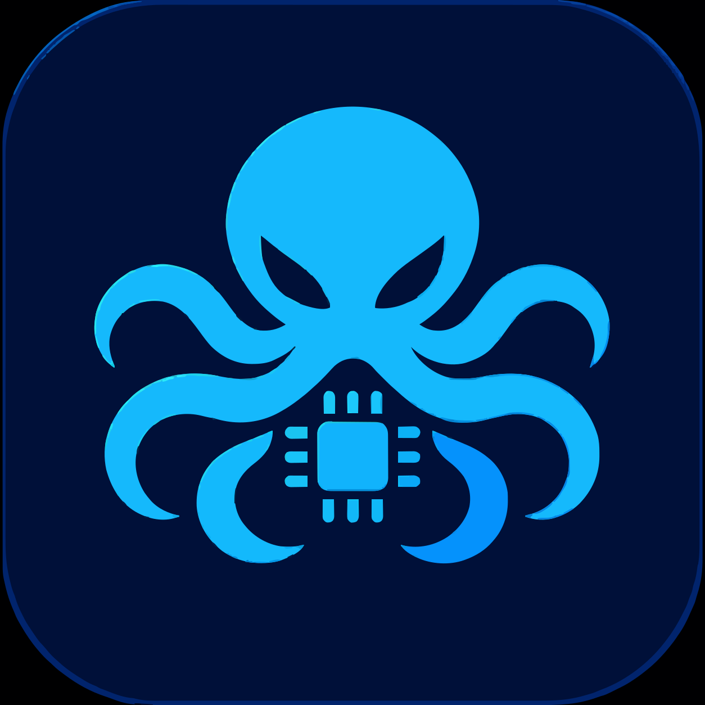

<div align="center">
  
  <h1>OctoAVR32A</h1>
  <p><strong>A lightweight AVR C development environment for Android.</strong></p>
  <p>
    
    
    
    
    
  </p>
</div>

**OctoAVR32A** is an Android-based, touch-friendly IDE prototype created to write and compile AVR C firmware directly on Android devices. The current development target is the classic **ATmega32A / ATmega32** family, with an ARMv7 (32-bit) Android toolchain packaged by the project build workflow.

> This repository is an evolving proof of concept. The current C compiler pipeline has produced working HEX and ELF outputs in project testing. Arduino `.ino` preprocessing/core integration and direct USBasp programming from inside the app are not yet complete.

## ✨ Highlights

- **Android-first editor:** responsive layout for phones and tablets.
- **AVR C workflow:** edit, Verify, and Build C source for ATmega32A or ATmega32.
- **Compiler toolchain:** bundled AVR-GCC, AVR Binutils and AVR-LibC for Android ARMv7.
- **Firmware outputs:** generate `.hex` (Intel HEX) and `.elf` files, then export them through Android's document picker.
- **Target selection:** ATmega32A / ATmega32.
- **Clock selection:** 1, 4, 8 or 16 MHz; the selected value is passed as `F_CPU` during Verify and Build. Choose the value that matches the actual clock configuration of your hardware.
- **Editor features:** line numbers, syntax coloring, current-line highlight, file tabs and source search.
- **Console:** collapsible build output and diagnostic messages.
- **Appearance:** Dark Navy and Light themes.
- **Build automation:** GitHub Actions builds the Android APK and publishes it as a workflow artifact.

## 📱 Compatibility

| Item | Current target |
|---|---|
| Platform | Android |
| Minimum Android API | 26 (Android 8.0) |
| CPU architecture | ARM 32-bit (armeabi-v7a / ARMv7) |
| Main MCU targets | ATmega32A, ATmega32 |
| Default clock selection | 8 MHz |
| Source workflow | AVR C (`.c`) |
| Firmware outputs | `.hex`, `.elf` |

The app is designed for small phone screens as well as tablets. Actual performance depends on the Android device's available RAM, storage and CPU.

## 🧰 Current functionality

| Feature | Status |
|---|---|
| Edit and manage C source | Available |
| Open / Save source files | Available |
| Verify C source with AVR-GCC | Available |
| Build and link AVR C firmware | Available; tested in the project workflow |
| Export Intel HEX and ELF | Available after a successful build |
| ATmega32A / ATmega32 selection | Available |
| Selectable `F_CPU` | Available |
| Dark / Light appearance | Available |
| Responsive editor, tabs and line numbers | Available |
| Arduino `.ino` preprocessing and full Arduino AVR Core build | Not integrated yet |
| Direct USBasp upload inside the app | Not implemented; use a compatible external programmer app/tool |
| Support for other AVR families / Arduino boards | Not currently in scope |

**Important clock note:** selecting a frequency only sets the compiler's `F_CPU` definition. It does not change fuse bits, clock-source fuses, prescalers or the physical oscillator on the microcontroller. Make sure the selected frequency matches the board's real clock setup.

## 🚀 Download the APK

1. Open the repository's [Actions page](https://github.com/Octopus205/AVR32-Studio/actions).
2. Select the latest successful **Android APK build** workflow run.
3. Find the **Artifacts** section and download `OctoAVR32A-debug`.
4. Extract the downloaded ZIP and install the APK on a compatible Android device.

[](https://github.com/Octopus205/AVR32-Studio/actions)

## 🛠️ Build from source

The Android project uses Kotlin and Gradle.

- Open the repository in Android Studio on a desktop development machine.
- Use JDK 17 and Gradle 8.2 as configured in the GitHub Actions workflow.
- Run:

```bash
gradle assembleDebug
```

The CI workflow also downloads and assembles the Android ARMv7 AVR toolchain and MightyCore source package before building the APK.

## 🗺️ Roadmap

- [ ] Complete Arduino `.ino` preprocessing and AVR core integration.
- [ ] Add project/workspace management and improved file navigation.
- [ ] Evaluate native USB host programming support for USBasp.
- [ ] Expand supported MCU families and board profiles in a controlled way.
- [ ] Add more editor productivity features and diagnostics.

The current release remains focused on ATmega32A / ATmega32. Broader Arduino IDE functionality is a future direction, not a current compatibility claim.

## 📚 Project references

- [AVR Libc documentation](https://www.nongnu.org/avr-libc/user-manual/)
- [GCC AVR options](https://gcc.gnu.org/onlinedocs/gcc/AVR-Options.html)
- [MightyCore (MCUdude)](https://github.com/MCUdude/MightyCore)
- [Android Developers: Create and share files](https://developer.android.com/training/data-storage/shared/documents-files)

## 🤝 Contributing

Issues and focused contributions are welcome. Please include the target MCU, selected clock, Android version and the complete compiler output when reporting a build problem.

---

<div align="center">
  <sub>OctoAVR32A · An Android AVR IDE prototype · Built for learning, testing and embedded development</sub>
</div>
